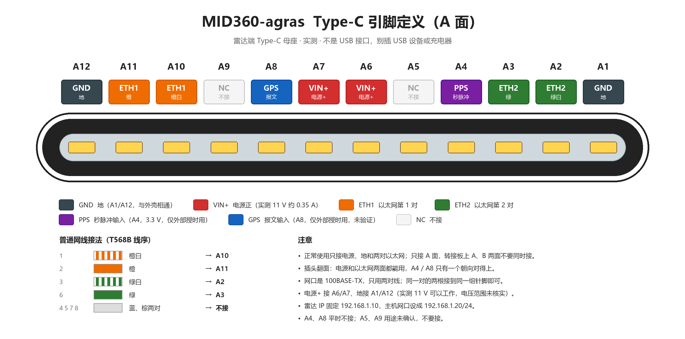

# T100 / MID360-agras：从网口点云到 ROS 2 + FAST-LIO2

[协议细节](integrations/mid360_agras_t100_lidar_driver/docs/protocol.zh-CN.md) · [原始完整工程 README](integrations/mid360_agras_t100_lidar_driver/README.md) · [许可证说明](docs/LICENSING.md)

这个仓库现在有两条互补的开发路线：

1. **推荐的实机接入路线：原生 C++ 驱动 + ROS 2 + FAST-LIO2。** 完整工程从公开仓库导入到 \`integrations/mid360_agras_t100_lidar_driver/\`，包含 Linux UDP 驱动、ROS 2 节点、FAST-LIO2 工作区、全周扫描配置工具、录包/导图脚本和 Windows 点云查看器。
2. **协议研究路线：Python T100 工具包。** 仓库根目录的 \`src/t100_lidar/\`、\`extras/\`、\`tests/\` 保留了另一套协议解析、参数读写、UDP 模拟器和测试工具。它适合继续做协议研究，不是目前首选的高点率 SLAM 驱动。

**如果你的目标是把 500 元的 T100 当作普通 MID-360 一样接入 FAST-LIO2，请先走第一条路线。** 不需要先把 Python 桥接改成 C++，也不需要 Livox-SDK2。

原 Python 协议工具的详细命令和模拟器说明仍保留在 [docs/PYTHON_TOOLKIT.zh-CN.md](docs/PYTHON_TOOLKIT.zh-CN.md)。

## 1. 先看懂整个数据链

\`\`\`text
T100 / MID360-agras
    │
    │  定制 Type-C：11V 电源 + 100BASE-TX Ethernet
    ▼
网线 / 电脑或开发板有线网口
    │
    │  UDP 60001：点云
    │  UDP 60003：IMU
    ▼
linux/mid360_agras.cpp
    │  C++17 / POSIX UDP
    │  解包、过滤无回波点、逐点时间、丢包统计、10Hz 组帧
    ▼
mid360_agras_ros ROS 2 节点
    │
    ├── /livox/lidar  : livox_ros_driver2/CustomMsg
    ├── /livox/imu    : sensor_msgs/Imu
    └── /livox/points : sensor_msgs/PointCloud2（RViz 查看）
    ▼
FAST-LIO2
    │
    ├── /Odometry
    ├── /path
    └── /cloud_registered
\`\`\`

它实现的是 **Livox ROS 消息接口兼容**：FAST-LIO2 继续订阅熟悉的 \`/livox/lidar\` 和 \`/livox/imu\`，底层数据却由 T100 原生 UDP 驱动提供。它不是 Livox-SDK2 仿真器，也不代表所有 Livox SDK API 都兼容。

## 2. 目录应该看哪里？

| 路径 | 用途 | 什么时候看 |
|---|---|---|
| \`integrations/mid360_agras_t100_lidar_driver/linux/\` | 独立 C++17 UDP 驱动和 demo | 不用 ROS，先验证能不能收到点云 |
| \`integrations/mid360_agras_t100_lidar_driver/ros2_ws/src/mid360_agras_ros/\` | ROS 2 驱动节点、launch、FAST-LIO 专用参数 | 正式接入 ROS 2 |
| \`integrations/mid360_agras_t100_lidar_driver/ros2_ws/src/FAST_LIO/\` | FAST-LIO2 ROS 2 工作区源码 | 建图、定位、修改参数 |
| \`integrations/mid360_agras_t100_lidar_driver/ros2_ws/src/livox_ros_driver2/\` | Livox CustomMsg / CustomPoint 消息定义 | 让 FAST-LIO2 保持原消息接口 |
| \`integrations/mid360_agras_t100_lidar_driver/tools/\` | 360° FOV 解锁、ROI、方位覆盖统计 | 点云缺一块或检查扫描覆盖 |
| \`integrations/mid360_agras_t100_lidar_driver/scripts/\` | 网络、编译、运行、录屏、bag 导出、PCD 导出 | 日常使用 |
| \`integrations/mid360_agras_t100_lidar_driver/windows_viewer/\` | Windows 实时点云和 PCD 查看器 | 不想先搭 ROS 时查看数据 |
| 根目录 \`src/t100_lidar/\` | Python 协议解析、控制、模拟器 | 继续逆向协议、写自动化测试 |

导入的完整工程保留了原作者 README、协议文档、来源记录、图片和许可证。原始项目地址及导入提交见 [docs/AGRAS_INTEGRATION.md](docs/AGRAS_INTEGRATION.md)。

## 3. T100 接线与供电：先别把它当 USB-C

雷达上的 Type-C 外形连接器是**定制复合接口，不是 USB**。不要插电脑 USB 口、普通 USB-C 充电器或 PD 触发板。

当前导入工程的 A 面针脚图和协议说明给出的正常接线如下：

| 功能 | A 面针脚 | 接法 |
|---|---|---|
| 电源正 | A6、A7 | 接受控、稳压的约 11V 电源 |
| GND | A1、A12、外壳 | 电源地 |
| Ethernet 第一对 | A10、A11 | T568B 橙白、橙 |
| Ethernet 第二对 | A2、A3 | T568B 绿白、绿 |
| PPS | A4 | 3.3V 脉冲输入，普通使用不接 |
| GPS 报文 | A8 | 外部授时输入，未验证，不接 |
| 未确认 | A5、A9 | 不接 |

网口是 100BASE-TX，只使用两对双绞线。蓝色、棕色两对不接。

<badge color="warning">与早先流传的 24Pin 图有冲突</badge>

此前讨论过的图把 A8/B5 标成秒脉冲、A5/B8 标成 GPS 脉冲，并给 A9/B4 标注预留 IO。新导入工程的实测 A 面图则是 A4=PPS、A8=GPS 报文、A5/A9=NC。**不要把两张图拼起来接线。** 当前整合以新工程的 A 面定义为基准；在制作 PCB 前仍建议用万用表复核触点方向和内部连通性。新工程明确建议只接 A 面，不要在转接板上把 A、B 两面同时短接。

供电实测点是约 **11V、0.345A（约 3.8W）**，不是已确认的完整额定范围。第一次上电建议用可调实验电源，先设 11.0V、限流约 1A，确认启动电流、稳态电流和温升。不要因为电源总线标称 12V 就未经验证直接接入。

## 4. 网络配置

导入工程记录的默认网络参数：

| 项目 | 值 |
|---|---|
| 雷达 IP | \`192.168.1.10\` |
| 主机有线网口 | \`192.168.1.20/24\` |
| 点云 UDP | \`60001\` |
| IMU UDP | \`60003\` |
| 控制命令 UDP | \`60000\` |

雷达上电且以太网链路建立后会主动推送数据。网线刚插上时，链路可能需要约一分钟。UDP 60001 同一时间只能由一个程序绑定；如果有网页雷达服务或另一个驱动占用，先停止它。

## 5. 最短实机路线：Ubuntu 22.04 + ROS 2 Humble

下面命令都在导入工程目录执行：

\`\`\`bash
cd integrations/mid360_agras_t100_lidar_driver

# 1) 设置雷达专用有线网口为 192.168.1.20/24
sudo ./scripts/setup_network.sh
# 如果自动选错网卡，明确指定，例如：
# sudo ./scripts/setup_network.sh eth0

# 2) 首次编译。先确保系统已经安装 ROS 2 Humble。
./scripts/build_all.sh --deps

# 3) 先不启动 ROS，验证 C++ 驱动是否收到数据
./scripts/run.sh demo

# 4) 查看原始点云
./scripts/run.sh view

# 5) 启动 FAST-LIO2 建图，不打开 RViz（适合 SSH/headless）
./scripts/run.sh mapping_norviz

# 需要 RViz 时：
./scripts/run.sh mapping
\`\`\`

\`build_all.sh --deps\` 安装工程依赖，不负责替你安装完整 ROS 2 发行版。如果只想编译独立 C++ 驱动、不装 ROS，可以使用：

\`\`\`bash
./scripts/build_all.sh --deps --no-ros
./scripts/run.sh demo
\`\`\`

脚本为 8GB 内存的 Jetson Orin Nano 限制了并行编译任务。若在其他平台编译失败，先看对应包的编译日志，不要直接假设是雷达协议问题。

## 6. Windows 查看器

1. 将电脑有线网卡设为 \`192.168.1.20/24\`。
2. 放行 UDP 60001。
3. Python 3.10 或更新版本。
4. 双击 \`integrations/mid360_agras_t100_lidar_driver/windows_viewer/查看点云.bat\`。

也可以把 PCAP/PCAPNG 拖进窗口回放。PCD 地图查看器使用同目录的 \`pcd_viewer.bat\`。

## 7. 360° 全周扫描：这不是刷固件

新工程发现雷达上电默认扫描存在约 65° 方位缺口。它提供运行时配置工具：

\`\`\`bash
cd integrations/mid360_agras_t100_lidar_driver

# 读取关键参数，不修改设备
python3 tools/mid360_fov.py --read

# 打开全周扫描并恢复数据流
python3 tools/mid360_fov.py --unlock

# 只查看方位覆盖，不发送控制命令
python3 tools/pcl_measure.py
\`\`\`

这里的“解锁”是向雷达发送配置命令，改变 ROI 和目标工作状态，不是破解或刷写固件。断电/重启后扫描状态会回到开机默认，需要重新执行。原项目的 \`scripts/run.sh\` 默认会在启动前尝试解锁；跳过可设 \`UNLOCK=0\`。

## 8. 数据到底是什么？

导入工程的协议说明和 C++ 解码实现记录：

- 点云 UDP 60001：36 字节包头，典型 Cartesian 包为 96 个点槽，每点 14 字节。
- XYZ：有符号 int32，单位 mm；ROS 输出转换为 m。
- 每点还有 reflectivity 和 tag。
- \`frame_cnt\` 在该固件上一直为 0，驱动不能依赖它切帧。
- \`time_interval\` 单位 0.1 μs；逐点时间按 \`timestamp + i × time_interval × 100 / dot_num\` 计算。
- IMU UDP 60003：gyro 为 rad/s；加速度原始单位 g，乘以 9.80665 转成 m/s²。
- IMU 实测约 180–200Hz；ROS 点云默认约 10Hz。

无回波点可能是全零坐标或 200m 标记点。默认驱动过滤 0.05m 以下和 100m 以上点；原始点槽数不等于有效回波数。

## 9. FAST-LIO2 配置与实测边界

专用配置位于：

\`ros2_ws/src/mid360_agras_ros/config/fastlio_mid360_agras.yaml\`

它从 FAST-LIO2 的 \`mid360.yaml\` 改来，主要包括：

- \`scan_line: 4\`，使用四线交错编号。
- \`timestamp_unit: 3\`，CustomMsg 的 offset_time 按 ns。
- \`filter_size_surf/map: 0.15m\`，是原作者针对楼梯间走动测试调整的参数。
- \`point_filter_num: 2\`。
- \`extrinsic_T: [-0.011, -0.02329, 0.04412]\`，\`extrinsic_R\` 为单位阵。

**不要盲目照抄这组外参。** 它对应原作者的安装方式；你的雷达安装位置、朝向和 IMU 坐标关系必须重新确认。若雷达重装，FAST-LIO 的外参和坐标系也要重新核对。

原作者公开的实测平台是 Jetson Orin Nano + ROS 2 Humble：包括静止测试和实机建图记录。当前没有该工程在 Orange Pi 5B 或 RDK X5 上的可靠性能实测，不能把 Orin Nano 的结果直接当成这两块板的结果。

## 10. 已知限制：先把它当研究平台，不要直接上飞控闭环

- 驱动按当前 T100 固件的包结构解析；不是所有 DJI/Livox 型号的通用驱动。
- C++ 解析器当前没有完整验证所有包头字段、CRC 和不同固件版本。
- 协议中的 time_type=0 是雷达上电后的本地时钟；原工程用一个共同偏移把点云和 IMU 映射到主机时间。PTP/GPS 时间模式尚不能视为已验证。
- 原始 tag、line 映射、IMU 轴方向、时间间隔和点云/IMU 时间基准都应使用真实 PCAP 与实机运动测试复核。
- 目前原作者的建图验证不能证明高速无人机、剧烈振动或炸机环境下仍然可靠。
- 360° FOV 配置、数据流目标地址和采样状态可能在重启后变化；每次上电都应检查。

推荐先做：静止收包 → 手持慢速走动建图 → 原地旋转 → 快速运动 → 录包回放 → 再考虑上机。不要把尚未验证的点云定位结果直接作为唯一飞行安全来源。

## 11. 本仓库的许可不是单一许可证

- 根目录原有 Python 协议工具及其原创文档：T100 Non-Commercial License 1.0。
- \`integrations/mid360_agras_t100_lidar_driver/\`：导入工程按 GPL-2.0，保留原许可证和来源记录。
- 其中 Livox CustomMsg / CustomPoint 消息定义：MIT，保留对应 LICENSE.txt。
- FAST-LIO / ikd-Tree：GPL-2.0。

不要把根目录的非商业许可证覆盖到 GPL 子工程，也不要删除子工程中的许可证和版权声明。细节见 [许可证说明](docs/LICENSING.md)。

## 12. 来源

完整导入自 [AkiyamaYukina/mid360_agras_t100_lidar_driver](https://github.com/AkiyamaYukina/mid360_agras_t100_lidar_driver)，上游提交：

\`492b4a237741a051f6cd0eb118dabd4e1b756e90\`

导入保留了原始目录结构、源码、协议文档、图片、脚本和第三方许可证。整合说明见 [docs/AGRAS_INTEGRATION.md](docs/AGRAS_INTEGRATION.md)。
