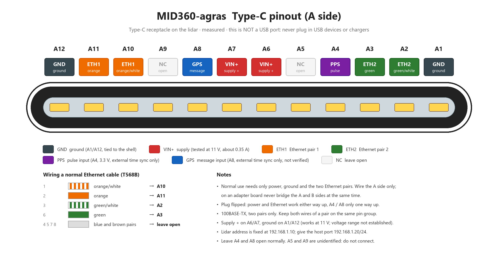

# MID360-agras (T100) LiDAR Driver — Ethernet / UDP, ROS2, FAST-LIO

[简体中文](README.md) · [Protocol reference](docs/protocol.en.md) · [Sources](docs/SOURCE.en.md)

The LiDAR on the DJI T100 agricultural drone is an agricultural version of the Mid-360 with a Type-C connector; this repository calls it MID360-agras. Included here: the Type-C pinout and wiring, a standalone C++ driver, a ROS2 node, a FAST-LIO configuration, a Windows point cloud viewer, and a tool that opens the full 360° scan. Livox-SDK2 is not needed.

Unofficial: written independently, with no affiliation to DJI or Livox. The firmware is not modified; the scan range and working state return to the power-on defaults when the LiDAR loses power.

## Common questions

### Is there a T100 LiDAR driver?

`linux/` is a standalone C++ driver, `ros2_ws/` holds the ROS2 node, and `windows_viewer/` is a point cloud viewer for Windows. The LiDAR starts streaming by itself once it has power and an Ethernet link; the drivers only receive. Only `tools/mid360_fov.py` sends configuration commands. The viewer and the start scripts call it automatically.

### How do I connect the Type-C port?

It is **not a USB port**. It carries power, ground and one 100 Mbit/s Ethernet link. Wire the two Ethernet pairs to a normal Ethernet cable and set the computer's port to `192.168.1.20/24`. See [Wiring and power](#wiring-and-power).

### Why is part of the point cloud missing?

After power-on the firmware scans only part of the circle: about 65° at the rear right has no points. `python3 tools/mid360_fov.py --unlock` opens the full circle. See [Unlocking the full circle](#unlocking-the-full-circle). It has to be repeated after every power cycle or reboot, which the viewer and the start scripts do for you.

### Do I need the Livox SDK or livox_ros_driver2?

No. `ros2_ws/src/livox_ros_driver2/` contains only the two Livox message definitions (`CustomMsg`, `CustomPoint`) so that FAST-LIO and other programs written for Livox messages can subscribe directly.

### Where is the DJI LiDAR protocol?

The [protocol reference](docs/protocol.en.md) covers the packet formats, commands and parameters used in this repository. It describes this LiDAR only and makes no claim about other DJI models.

## Wiring and power



The Type-C connector on the LiDAR is not USB. **Never plug in a USB device or charger.**

| Function | Type-C pins |
|---|---|
| Supply + (0.345 A at 11 V, about 3.8 W) | A6, A7, B6, B7 |
| Ground | A1, A12, B1, B12, shell |
| Ethernet pair 1 | A10 / A11 (connected to B3 / B2) |
| Ethernet pair 2 | A2 / A3 (connected to B11 / B10) |
| PPS pulse input (3.3 V) | A4, external time sync only |
| GPS message input | A8, external time sync only, **not verified** |
| Unidentified | A5, A9: do not connect |

- Normal Ethernet cable (T568B): orange pair to A10 / A11, green pair to A2 / A3. The link is 100BASE-TX and uses two pairs.
- Wire the A side only. On an adapter board, do not bridge the A and B sides with 0 Ω resistors at the same time.
- With the plug flipped, power and Ethernet keep working. A4 and A8 line up in one orientation only.
- 11 V works. The supply voltage range has not been established.
- External time synchronization is not part of this repository. Leave A4 and A8 open in normal use.

## Network

| | Address |
|---|---|
| LiDAR | `192.168.1.10`, fixed |
| Host | `192.168.1.20/24` (the default destination of the LiDAR's data) |
| Point cloud | UDP `60001`, 96 point slots per packet |
| IMU | UDP `60003`, 180–200 Hz, acceleration in g |
| Configuration | UDP `60000` |

Streaming starts as soon as the LiDAR has power and a link; no host command is needed. A freshly connected link can take about a minute to come up. Only one program at a time can own UDP `60001`.

## Quick start: Linux

Ubuntu 22.04, ROS2 Humble optional. Used on a Jetson Orin Nano.

```sh
git clone https://github.com/AkiyamaYukina/mid360_agras_t100_lidar_driver.git
cd mid360_agras_t100_lidar_driver
sudo ./scripts/setup_network.sh      # finds the wired port; or name it: sudo ./scripts/setup_network.sh eth0
./scripts/build_all.sh --deps        # --deps installs dependencies the first time; add --no-ros without ROS2
./scripts/run.sh demo                # no ROS: prints packet rate, points and IMU every second
./scripts/run.sh view                # driver + RViz2 with the raw point cloud
./scripts/run.sh mapping             # driver + FAST-LIO + RViz2 (mapping_norviz: without RViz)
```

- `setup_network.sh` creates a NetworkManager profile `livox-mid360` (persistent, never the default route) and raises the UDP receive buffer limit to 16 MB in `/etc/sysctl.d/90-livox-mid360.conf`.
- FAST-LIO can run out of memory while compiling on 8 GB boards, so `build_all.sh` builds one package at a time with at most 4 threads.
- `run.sh` unlocks the full circle before starting. Set `UNLOCK=0` to skip that.
- `lidar_web.py` / `lidar-web` in the scripts is a web service on the author's own machine that has to release UDP `60001`. On other machines those lines do nothing.

## Quick start: Windows

1. Set the computer's Ethernet port to `192.168.1.20/24`. Administrator prompt: `netsh interface ipv4 set address name="Ethernet" static 192.168.1.20 255.255.255.0`
2. Allow inbound UDP `60001` in the firewall. With a proxy in TUN mode, route `192.168.1.0/24` directly.
3. Install the dependencies and start the viewer (Python 3.10 or newer):

```bat
python -m pip install numpy PyQt5 pyqtgraph PyOpenGL
python windows_viewer\mid360_viewer.py
```

On a Chinese Windows system you can double-click `windows_viewer\查看点云.bat` instead; it installs the dependencies on the first run. The viewer's interface is in Chinese. Without live data for 3 seconds it replays the newest capture in `windows_viewer/captures/`; `.pcap` / `.pcapng` files can also be dropped onto the window. `R` resets the view, `T` is the top view, space pauses.

`windows_viewer\pcd_viewer.bat` shows mapping results (`map.pcd`). A `trajectory.csv` next to the file is drawn as a line; the part where FAST-LIO diverged is red.

## Unlocking the full circle

After power-on the firmware scans only part of the circle. Unlocking takes three steps, all of them runtime commands:

1. write 0 to `roi_en` to open the full circle;
2. set the target state to 1 (sampling);
3. write the point cloud and IMU destination back to this host and enable sampling.

| | Power-on default | Unlocked |
|---|---|---|
| Azimuth | about 65° at the rear right has no points | points all around |
| Point packet rate | about 3100 packets/s | about 2080 packets/s |
| Target state (`32/51`) | 2 | 1 |

Every packet has 96 point slots, some of which carry no return. The packet rate tells you which mode the LiDAR is in.

### Automatic

| Entry point | When it unlocks | How to turn it off |
|---|---|---|
| Windows viewer | once at start, then reads the target state every 5 s and unlocks again if it is not 1; the result is shown in the status bar, without pop-ups | — |
| `scripts/run.sh` | once before the driver starts | `UNLOCK=0` |
| `scripts/fastlio_walk.sh` | once before the driver starts, result in `logs/walk.log` | `WALK_NO_UNLOCK=1` |

Starting the nodes directly with `ros2 launch` or `ros2 run` does **not** unlock: the node only receives. On Linux, run the script again if the LiDAR restarts while mapping.

### Manual

```sh
python3 tools/mid360_fov.py --unlock      # full circle + target state 1 + restore the streams
python3 tools/mid360_fov.py --full        # full circle only
python3 tools/mid360_fov.py --read        # read only: check that the LiDAR answers
python3 tools/mid360_fov.py --roi 0 180   # keep the 0-180 degree sector (start > end crosses 0)
python3 tools/mid360_fov.py --restore     # no points arriving: write the destination back to this host
python3 tools/pcl_measure.py              # receive only: 6 s census, lists azimuths without points
```

Standard library only; works on Windows (use `python`), Linux and macOS. Exit codes of `--unlock`: 0 done, 1 a step failed, 2 the LiDAR does not answer. `--device` and `--host` change the LiDAR and host address (defaults `192.168.1.10` and `192.168.1.20`). The tool's messages are in Chinese.

### After a power cycle or reboot

- Scan range and target state return to the power-on defaults. Unlock again.
- **Do not judge by `roi_en`.** After a reboot it still reads 0 although the LiDAR is back in its power-on scan mode. Use the target state (`32/51`) or the packet rate.
- Stored parameter values are not necessarily reset: one parameter still read back as written after a power cycle.

## ROS2 node

`mid360_agras_node` is built on the driver in `linux/`, without the Livox SDK.

| Topic | Type | Notes |
|---|---|---|
| `/livox/lidar` | `livox_ros_driver2/CustomMsg` | one frame every 0.1 s, the FAST-LIO input; `offset_time` in ns |
| `/livox/imu` | `sensor_msgs/Imu` | acceleration converted to m/s² |
| `/livox/points` | `sensor_msgs/PointCloud2` | the same frames for RViz, built only while someone subscribes |

Parameters: `lidar_ip` (192.168.1.10), `bind_ip` (0.0.0.0), `point_port` (60001), `imu_port` (60003), `frame_id` (livox_frame), `frame_period` (0.1 s), `min_range` / `max_range` (0.05 / 100 m), and `lidar_topic`, `imu_topic`, `cloud_topic`.

```sh
source /opt/ros/humble/setup.bash && source ros2_ws/install/setup.bash
ros2 launch mid360_agras_ros driver.launch.py rviz:=true
ros2 launch mid360_agras_ros mapping.launch.py rviz:=false
```

**Time stamps**: the LiDAR clock counts from power-on. At the first packet the node takes the offset to host time and adds the same offset to points and IMU from then on, so both stay on one clock. The offset is taken again when the LiDAR restarts (its clock jumps back).

## FAST-LIO mapping

The configuration is `ros2_ws/src/mid360_agras_ros/config/fastlio_mid360_agras.yaml`. It starts from FAST_LIO's `mid360.yaml`; every changed value is commented with the original and the reason. The most important one is the voxel size: on a stairwell walk on 2026-11-05 the default 0.5 m lost track while turning at the top of the stairs. Each setting was replayed three times on the same recording:

| Setting | Runs without divergence (of 3) | p99 processing lag |
|---|---|---|
| voxel 0.5 m (original) | 0 | — |
| voxel 0.2 m | 2 | — |
| voxel 0.2 m + `max_iteration` 4 | 2 | 83 ms |
| voxel 0.2 m + `point_filter_num` 1 | 3 | 170 ms |
| **voxel 0.15 m (used here)** | **3** | **90 ms** |

All divergence happened during a few seconds of fast turning (about 140°/s) at the top of the stairs; turning more slowly in stairwells and corners helps. The settings have not been tuned again since.

**Recording a walk**: `scripts/install_walk_icon.sh` puts an icon on the desktop that runs `scripts/fastlio_walk.sh`. It needs a GNOME desktop and `ffmpeg xdotool zenity libnotify-bin x11-utils`; its messages are in Chinese. It unlocks the LiDAR, starts the driver and FAST-LIO, opens RViz full screen, and records the screen and a bag. Keep the LiDAR still for 3 seconds once it says it is recording, then walk; closing RViz saves everything to `~/fastlio_runs/<date_time>/`.

**Exporting a map**: `scripts/bag_to_pcd.py BAG OUT.pcd [--voxel 0.1] [--traj trajectory.csv] [--start S] [--end S]`. If a recording ended with a power loss, run `ros2 bag reindex BAG` first.

## Standalone C++ driver

Without ROS, copy `linux/mid360_agras.h` and `linux/mid360_agras.cpp` into your project. They need only C++17 and POSIX sockets.

```cpp
#include "mid360_agras.h"

mid360::Config cfg;               // defaults: 60001 / 60003, only 192.168.1.10, one frame per 0.1 s
mid360::Driver drv(cfg);
drv.on_frame([](const mid360::Frame& f) {
  // f.points: x/y/z (m, x forward, y left, z up), reflectivity, tag, line, timestamp_ns (LiDAR clock)
});
drv.on_imu([](const mid360::Imu& m) { /* gyro rad/s, accel m/s^2 */ });
if (!drv.start()) fprintf(stderr, "%s\n", drv.error().c_str());   // e.g. the port is already in use
```

- Callbacks run on the driver's own threads. The firmware always sends `frame_cnt` = 0, so frames are cut on the LiDAR clock every `frame_period_s`.
- Slots without a return (all zero, or the 200 m marker) are dropped unless `keep_no_return = true`.
- `FrameAssembler`, `parse_points` and `parse_imu` can be used on their own to parse packets.
- Example program: `mid360_agras_demo` (live statistics), `--pcd out.pcd 2` (2 s into a PCD file), `--pcap file.pcap` (offline parsing, no pcapng).

## Known differences and issues

- One return per shot.
- Measured elevation range: about −9° to 53°.
- One unit split flat walls and ceilings into two layers 0.2–0.3 m apart; this was a fault of that unit. Check a new unit by leaving it still and comparing ranges in the same direction across scans: the good unit had a median difference of 0.5 cm with 1% above 10 cm, the faulty one 7–20 cm with 40–60% above 10 cm.
- The FAST-LIO map frame is the LiDAR's frame at the start and is not levelled to gravity. If the LiDAR starts tilted by a few degrees, the height drifts over long walks on flat ground.
- FAST_LIO needs its `Log/` folder in the source tree, otherwise it crashes on exit (the data is not affected).

## Verification

| Date | Setup | Result |
|---|---|---|
| 2026-11-06 | Orin Nano, ROS2 Humble, LiDAR at rest | all three packages build; `/livox/lidar` 10.0 Hz, about 15800 points per frame, no lost packets; `/livox/imu` about 180 Hz; `/Odometry` 10 Hz, drift within 3 mm; CPU (100% = one core): FAST-LIO about 24%, node about 7% |
| 2026-11-22 | Orin Nano (L4T R36.5.2), real LiDAR | `build_all.sh` finished in 176 s; `run.sh mapping_norviz` unlocked with status 0 at every step and target state 1 on read-back; `/livox/lidar` 10.0 Hz, `/livox/imu` 200 Hz, `/Odometry` 9.3 Hz; 23 frames with about 368,000 points, and points in all 360 one-degree azimuth bins |
| 2026-11-24 | Ubuntu 22.04 (WSL2), fresh clone, no LiDAR | `linux/` compiles with `-Wall -Wextra` without warnings; the example program's `--pcap` on a synthetic capture (2083 point packets, 200 IMU packets) gives the expected frame, point and loss counts |
| 2026-11-24 | simulated LiDAR on loopback UDP, not real hardware | frames of the `mid360_fov.py` options and exit codes of `--unlock`; automatic unlock, unlock after a restart and the manual button of the Windows viewer |

Not yet verified on real hardware: the automatic unlock of the Windows viewer, `--roi`, `fastlio_walk.sh` since the unlock was added, and the GPS message input on A8. These results come from one or two units; other batches may differ.

## Layout

| Directory | Contents |
|---|---|
| `linux/` | standalone C++ driver and example program |
| `ros2_ws/src/mid360_agras_ros/` | ROS2 node, launch files, FAST-LIO configuration |
| `ros2_ws/src/livox_ros_driver2/` | Livox message definitions only |
| `ros2_ws/src/FAST_LIO/` | ROS2 branch of hku-mars/FAST_LIO with ikd-Tree, source unmodified |
| `scripts/` | network setup, build, start, mapping recorder, map export |
| `tools/` | `mid360_fov.py` unlock and sector configuration, `pcl_measure.py` passive azimuth census |
| `windows_viewer/` | live point cloud viewer and map viewer for Windows |
| `docs/` | protocol reference, sources, pinout diagrams |

## Before you use it

- The LiDAR is a laser product, and wrong power or wiring can damage it. Assess the risk yourself.
- The configuration commands change the scan range and working state. Do not use them where flight safety depends on the LiDAR.
- DJI, Agras, Livox and Mid-360 are trademarks of their owners and are used here only to identify the hardware.

## License

[GPL-2.0](LICENSE). Original parts Copyright (C) 2026 AkiyamaYukina.

- `ros2_ws/src/FAST_LIO/` (with ikd-Tree) comes from the MARS Lab, The University of Hong Kong, under GPL-2.0. Its `package.xml` says BSD while the repository's LICENSE is GPL-2.0; it is treated as GPL-2.0 here.
- The message definitions in `ros2_ws/src/livox_ros_driver2/` come from Livox under the MIT license, see `LICENSE.txt` there.

Upstream addresses, commits and changes of the third-party parts are listed in [Sources](docs/SOURCE.en.md).
