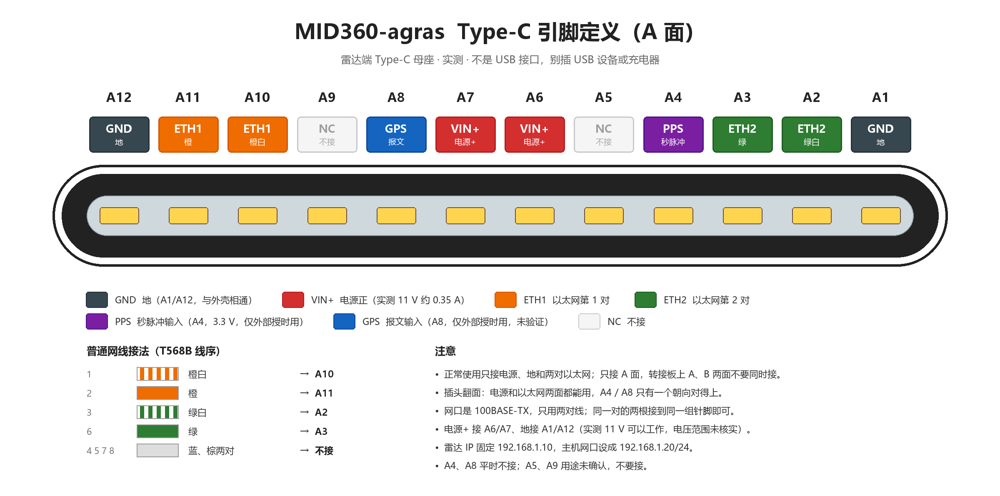

# MID360-agras（T100）激光雷达驱动：以太网 / UDP、ROS2、FAST-LIO

[English](README.en.md) · [协议说明](docs/protocol.zh-CN.md) · [来源记录](docs/SOURCE.md)

大疆 T100 农业无人机上的激光雷达是 Mid-360 的农机版，接口是 Type-C，本仓库叫它 MID360-agras。这里有它的 Type-C 引脚和接线、不依赖 ROS 的 C++ 驱动、ROS2 节点、FAST-LIO 建图配置、Windows 点云查看器，以及打开 360° 全周扫描的配置工具。不需要 Livox-SDK2。

Driver, Type-C pinout and protocol notes for the DJI Agras T100 LiDAR (MID360-agras): Ethernet / UDP, ROS2, FAST-LIO, full 360° scan. English: [README.en.md](README.en.md).

本项目是非官方的独立实现，和大疆、Livox 没有关系。不改固件；扫描范围和工作状态在雷达断电后会回到开机默认。

## 常见问题

### 有 T100激光雷达驱动吗？

有，就是本仓库。`linux/` 是独立 C++ 驱动，`ros2_ws/` 是 ROS2 节点，`windows_viewer/` 是 Windows 点云查看器。雷达上电、网口连通后会自己推流，驱动只收包。会发配置命令的只有 `tools/mid360_fov.py`，查看器和启动脚本会自动调用它。

### T100激光雷达的 Type-C 怎么接电脑？

这个 Type-C **不是 USB 口**，里面是电源、地和一路百兆以太网。把两对以太网线引出来接到普通网线上，电脑网口设成 `192.168.1.20/24` 就能收到数据。见[接线和供电](#接线和供电)。

### T100激光雷达点云为什么缺一块？怎么打开 360°？

固件开机时只扫一部分方位，右后方约 65° 没有点。运行 `python3 tools/mid360_fov.py --unlock` 就能打开全周，见[解锁 360° 全周](#解锁-360-全周)。雷达断电或重启后要再运行一次，本仓库的查看器和启动脚本会自动做这件事。

### 需要 Livox SDK 或 livox_ros_driver2 吗？

不需要。`ros2_ws/src/livox_ros_driver2/` 里只有 Livox 的两个消息定义（`CustomMsg`、`CustomPoint`），没有驱动，这样 FAST-LIO 等按 Livox 消息写的程序可以直接订阅。

### 大疆激光雷达协议在哪里？

本仓库用到的数据包格式、配置命令和参数见[协议说明](docs/protocol.zh-CN.md)。它只覆盖这台雷达上用到的部分，不代表适用于大疆其他型号。

## 接线和供电



雷达上的 Type-C 不是 USB 接口，**不要插 USB 设备或充电器**。

| 功能 | Type-C 引脚 |
|---|---|
| 电源 +（实测 11 V 时 0.345 A，约 3.8 W） | A6、A7、B6、B7 |
| GND | A1、A12、B1、B12、外壳 |
| 以太网第 1 对 | A10 / A11（与 B3 / B2 相通） |
| 以太网第 2 对 | A2 / A3（与 B11 / B10 相通） |
| PPS 秒脉冲输入（3.3 V） | A4，仅外部授时用 |
| GPS 报文输入 | A8，仅外部授时用，**未验证** |
| 未确认 | A5、A9，不要接 |

- 普通网线（T568B）：橙色对接 A10 / A11，绿色对接 A2 / A3。网口是 100BASE-TX，只用两对线。
- 只接 A 面。转接板上 A、B 两面不要同时用 0 Ω 电阻接通。
- 插头翻面后，电源和以太网照常能用；A4、A8 只有一个朝向对得上。
- 供电实测 11 V 可以工作，电压范围没有核实过。
- 本仓库不包含外部授时功能，正常使用时 A4、A8 不接。

## 网络

| | 地址 |
|---|---|
| 雷达 | `192.168.1.10`，固定 |
| 主机 | `192.168.1.20/24`（雷达默认把数据发到这个地址） |
| 点云 | UDP `60001`，每包 96 个点槽 |
| IMU | UDP `60003`，180–200 Hz，加速度单位是 g |
| 配置命令 | UDP `60000` |

雷达上电、网口连通后就开始推流，不需要主机发命令。网口刚插上时，链路可能要大约 1 分钟才起来。UDP `60001` 同一时间只能被一个程序占用。

## 快速开始：Linux

Ubuntu 22.04，ROS2 Humble 可选。在 Jetson Orin Nano 上用过。

```sh
git clone https://github.com/AkiyamaYukina/mid360_agras_t100_lidar_driver.git
cd mid360_agras_t100_lidar_driver
sudo ./scripts/setup_network.sh      # 自动找有线网口，也可以指定：sudo ./scripts/setup_network.sh eth0
./scripts/build_all.sh --deps        # 第一次带 --deps 装依赖；没装 ROS2 就加 --no-ros
./scripts/run.sh demo                # 不用 ROS，每秒打印包速率、点数和 IMU
./scripts/run.sh view                # 驱动 + RViz2，看原始点云
./scripts/run.sh mapping             # 驱动 + FAST-LIO + RViz2（mapping_norviz 不开 RViz）
```

- `setup_network.sh` 会建一个 NetworkManager 配置 `livox-mid360`（开机自动生效，不抢默认路由），并把 UDP 接收缓冲区上限调到 16 MB（写入 `/etc/sysctl.d/90-livox-mid360.conf`）。
- 8 GB 内存的板子上编译 FAST-LIO 容易内存不够，所以 `build_all.sh` 每次只编一个包，最多 4 线程。
- `run.sh` 启动前会自动解锁 360° 全周，不想要就加 `UNLOCK=0`。
- 脚本里的 `lidar_web.py` / `lidar-web` 是作者自己机器上的网页服务，用来让出 UDP `60001`；你的机器上没有它时，这几行什么都不做。

## 快速开始：Windows

1. 把电脑网口设成 `192.168.1.20/24`。管理员命令行：`netsh interface ipv4 set address name="以太网" static 192.168.1.20 255.255.255.0`
2. 防火墙放行 UDP `60001`。开着 Clash 之类代理的 TUN 模式时，把 `192.168.1.0/24` 设成直连，否则局域网 UDP 可能被劫持。
3. 双击 `windows_viewer\查看点云.bat`。第一次运行会自动安装依赖（Python 3.10 及以上，`numpy PyQt5 pyqtgraph PyOpenGL`）。

也可以直接运行 `python windows_viewer\mid360_viewer.py [录包.pcapng]`。3 秒内收不到实时数据时，会自动回放 `windows_viewer/captures/` 里最新的抓包；也可以把 `.pcap` / `.pcapng` 拖到窗口上。`R` 重置视角，`T` 俯视，空格暂停。

`windows_viewer\pcd_viewer.bat` 用来看建图结果 `map.pcd`，同目录的 `trajectory.csv` 会画成轨迹线，FAST-LIO 发散的部分画成红色。

## 解锁 360° 全周

固件开机时只扫一部分方位。“解锁”一共三步，全部是运行时配置命令：

1. `roi_en` 写 0，打开全周；
2. 把目标状态设成 1（采样）；
3. 把点云和 IMU 的目的地址写回本机，再打开采样使能。

| | 开机默认 | 解锁后 |
|---|---|---|
| 方位角 | 右后方约 65° 没有点 | 360° 都有点 |
| 点云包速率 | 约 3100 包/秒 | 约 2080 包/秒 |
| 目标状态（`32/51`） | 2 | 1 |

每包固定 96 个点槽，其中一部分没有回波。点云包速率可以用来判断雷达当前在哪种模式。

### 自动解锁

| 入口 | 什么时候解锁 | 关掉的方法 |
|---|---|---|
| Windows 查看器 | 启动时一次；之后每 5 秒读一次目标状态，不是 1 就再解锁。结果写在底部状态栏，不弹窗 | — |
| `scripts/run.sh` | 启动驱动前一次 | `UNLOCK=0` |
| `scripts/fastlio_walk.sh` | 启动驱动前一次，结果写在 `logs/walk.log` | `WALK_NO_UNLOCK=1` |

直接用 `ros2 launch` 或 `ros2 run` 启动节点时**不会**解锁，因为节点只收数据、不发命令。Linux 上建图中途雷达重启了，要重新运行脚本。

### 手动

```sh
python3 tools/mid360_fov.py --unlock      # 全周 + 目标状态 1 + 恢复数据流
python3 tools/mid360_fov.py --full        # 只打开全周
python3 tools/mid360_fov.py --read        # 只读，核对能不能连上雷达
python3 tools/mid360_fov.py --roi 0 180   # 只保留 0–180° 扇区（起点大于终点时跨 0°）
python3 tools/mid360_fov.py --restore     # 收不到点云时，把目的地址写回本机
python3 tools/pcl_measure.py              # 只收不发，统计 6 秒，列出没有点的方位
```

只用 Python 标准库，Windows / Linux / macOS 都能跑（Windows 上把 `python3` 换成 `python`）。`--unlock` 的退出码：0 成功，1 有一步没写成功，2 连不上雷达。`--device`、`--host` 可以改雷达和本机地址，默认 `192.168.1.10` 和 `192.168.1.20`。

### 断电和重启之后

- 雷达断电或重启后，扫描范围和目标状态回到开机默认，要重新解锁。
- **不要用 `roi_en` 判断有没有解锁。** 实测重启后它读回来仍是 0，但雷达已经回到开机默认的扫描方式。看目标状态（`32/51`）或点云包速率。
- 参数的存储值不一定随断电还原：实测有参数写入后断电重启，读回的仍是写入值。

## ROS2 节点

`mid360_agras_node` 基于 `linux/` 里的驱动，不用 Livox SDK。

| 话题 | 类型 | 说明 |
|---|---|---|
| `/livox/lidar` | `livox_ros_driver2/CustomMsg` | 每 0.1 秒一帧，FAST-LIO 的输入；`offset_time` 单位 ns |
| `/livox/imu` | `sensor_msgs/Imu` | 加速度已换算成 m/s² |
| `/livox/points` | `sensor_msgs/PointCloud2` | 同样的帧，给 RViz 看，有人订阅时才生成 |

参数：`lidar_ip`（192.168.1.10）、`bind_ip`（0.0.0.0）、`point_port`（60001）、`imu_port`（60003）、`frame_id`（livox_frame）、`frame_period`（0.1 秒）、`min_range` / `max_range`（0.05 / 100 m），以及 `lidar_topic`、`imu_topic`、`cloud_topic`。

```sh
source /opt/ros/humble/setup.bash && source ros2_ws/install/setup.bash
ros2 launch mid360_agras_ros driver.launch.py rviz:=true
ros2 launch mid360_agras_ros mapping.launch.py rviz:=false
```

**时间戳**：雷达时钟从上电开始计时。节点收到第一个包时记下雷达时间和本机时间的差，之后点云和 IMU 都加同一个差值，所以两者始终在同一个时钟上。雷达重启（时钟往回跳）时会重新取差值。

## FAST-LIO 建图

配置文件是 `ros2_ws/src/mid360_agras_ros/config/fastlio_mid360_agras.yaml`，从 FAST_LIO 自带的 `mid360.yaml` 改来，文件里每项都注明了原值和原因。改动最大的是体素：2026-11-05 走楼梯间时，默认的 0.5 m 在楼梯顶转身处失去跟踪。同一份数据包每组重放 3 次：

| 参数 | 3 次里没发散 | 处理延迟 p99 |
|---|---|---|
| 体素 0.5 m（原值） | 0 次 | — |
| 体素 0.2 m | 2 次 | — |
| 体素 0.2 m + `max_iteration` 4 | 2 次 | 83 ms |
| 体素 0.2 m + `point_filter_num` 1 | 3 次 | 170 ms |
| **体素 0.15 m（现在用的）** | **3 次** | **90 ms** |

发散都发生在楼梯顶快速转身（约 140°/s）的几秒里，拿着雷达走时在楼梯口和转角处转慢一点更稳。这组参数在那之后没有重新调过。

**建图录屏**：`scripts/install_walk_icon.sh` 在桌面放一个「FAST-LIO 建图录屏」图标（运行 `scripts/fastlio_walk.sh`），需要 GNOME 桌面，以及 `ffmpeg xdotool zenity libnotify-bin x11-utils`。双击后自动解锁、启动驱动和 FAST-LIO、开全屏 RViz、录屏并录数据包。看到“正在录制”后先让雷达静止 3 秒再走，走完关掉 RViz 窗口就会保存。结果在 `~/fastlio_runs/<日期_时间>/`。

**导出地图**：`scripts/bag_to_pcd.py BAG OUT.pcd [--voxel 0.1] [--traj trajectory.csv] [--start S] [--end S]`。中途断电的数据包先执行 `ros2 bag reindex BAG`。

## 独立 C++ 驱动

不想装 ROS 时，把 `linux/mid360_agras.h` 和 `linux/mid360_agras.cpp` 拷进自己的工程，只依赖 C++17 和 POSIX socket。

```cpp
#include "mid360_agras.h"

mid360::Config cfg;               // 默认：60001 / 60003，只收 192.168.1.10，每 0.1 s 一帧
mid360::Driver drv(cfg);
drv.on_frame([](const mid360::Frame& f) {
  // f.points: x/y/z (m，x 前 / y 左 / z 上)、reflectivity、tag、line、timestamp_ns（雷达时钟）
});
drv.on_imu([](const mid360::Imu& m) { /* gyro rad/s, accel m/s^2 */ });
if (!drv.start()) fprintf(stderr, "%s\n", drv.error().c_str());   // 端口被占用时会提示
```

- 回调运行在驱动自己的线程里。固件发的 `frame_cnt` 一直是 0，所以按雷达时钟每 `frame_period_s` 切一帧。
- 没有回波的点（全零点、200 m 的标记点）默认丢弃，`keep_no_return = true` 可保留。
- `FrameAssembler`、`parse_points`、`parse_imu` 可以单独用来解析数据包。
- 示例程序：`mid360_agras_demo`（实时统计）、`--pcd out.pcd 2`（录 2 秒存成 PCD）、`--pcap file.pcap`（离线解析，不支持 pcapng）。

## 已知差异和问题

- 每次发射只输出一个回波。
- 俯仰范围实测约 −9° 到 53°。
- 有一台雷达会把平整的墙和天花板分成相差 0.2–0.3 m 的两层，是单机问题。拿到新雷达先静止放着，看同一方向多次扫描的距离差：正常那台中位数 0.5 cm，超过 10 cm 的只有 1%；有问题那台中位数 7–20 cm，超过 10 cm 的有 40–60%。
- FAST-LIO 的地图坐标系就是起步时雷达的坐标系，没有按重力调平。起步时雷达倾斜几度，在平地走远了高度就会一直变。
- FAST_LIO 源码目录下必须有 `Log/` 文件夹，否则它退出时会段错误（数据不受影响）。

## 验证情况

| 日期 | 环境 | 内容 |
|---|---|---|
| 2026-11-06 | Orin Nano，ROS2 Humble，雷达静止 | 三个包编译通过；`/livox/lidar` 10.0 Hz、每帧约 15800 点、0 丢包；`/livox/imu` 约 180 Hz；`/Odometry` 10 Hz，漂移 3 mm 以内；CPU（单核 100%）：FAST-LIO 约 24%，节点约 7% |
| 2026-11-22 | Orin Nano（L4T R36.5.2），实机 | `build_all.sh` 176 秒编完；`run.sh mapping_norviz` 自动解锁每一步返回 0，目标状态读回 1；`/livox/lidar` 10.0 Hz、`/livox/imu` 200 Hz、`/Odometry` 9.3 Hz；收到 23 帧约 36.8 万点，360 个 1° 方位格都有点 |
| 2026-11-24 | Ubuntu 22.04（WSL2），全新克隆，没有雷达 | `linux/` 用 `-Wall -Wextra` 编译零警告；示例程序 `--pcap` 解析合成抓包（2083 个点云包、200 个 IMU 包），帧数、点数、丢包数和预期一致 |
| 2026-11-24 | 本机模拟雷达（回环 UDP，不是实机） | `mid360_fov.py` 各选项的报文和 `--unlock` 退出码；Windows 查看器的自动解锁、重启后再解锁、手动按钮 |

还没有在实机上验证的：Windows 查看器的自动解锁、`--roi`、加了自动解锁之后的 `fastlio_walk.sh`、A8 的 GPS 报文输入。以上结果来自一两台雷达，别的批次可能不同。

## 目录

| 目录 | 内容 |
|---|---|
| `linux/` | 独立 C++ 驱动和示例程序 |
| `ros2_ws/src/mid360_agras_ros/` | ROS2 节点、launch 文件、FAST-LIO 配置 |
| `ros2_ws/src/livox_ros_driver2/` | 只有 Livox 的消息定义 |
| `ros2_ws/src/FAST_LIO/` | hku-mars/FAST_LIO 的 ROS2 分支，含 ikd-Tree，源码未改动 |
| `scripts/` | 设网口、编译、启动、建图录屏、导出地图 |
| `tools/` | `mid360_fov.py` 解锁和扇区配置，`pcl_measure.py` 被动统计方位缺口 |
| `windows_viewer/` | Windows 实时点云查看器、建图结果查看器 |
| `docs/` | 协议说明、来源记录、接线图 |

## 使用须知

- 雷达是激光产品，供电和接线错误可能损坏设备，请自行评估风险。
- 本仓库的配置会改变雷达的扫描范围和工作状态，不要用在飞行安全相关的场合。
- DJI、大疆、Agras、Livox、Mid-360 是各自所有者的商标，这里只用来说明适用的硬件。

## 使用许可

本仓库按 [GPL-2.0](LICENSE) 发布，原创部分 Copyright (C) 2026 AkiyamaYukina。

- `ros2_ws/src/FAST_LIO/`（含 ikd-Tree）来自香港大学 MARS 实验室，GPL-2.0。它的 `package.xml` 写的是 BSD，但仓库的 LICENSE 是 GPL-2.0，这里按 GPL-2.0 对待。
- `ros2_ws/src/livox_ros_driver2/` 的消息定义来自 Livox，MIT，见其中的 `LICENSE.txt`。

第三方部分的上游地址、提交号和改动见[来源记录](docs/SOURCE.md)。
