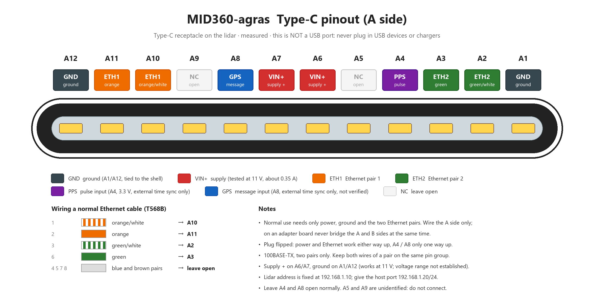

# MID360-agras (T100) LiDAR Ethernet protocol

[简体中文](protocol.zh-CN.md) · [Back to the home page](../README.en.md)

This document describes what the code in this repository actually uses: wiring, addresses and ports, point cloud and IMU packets, configuration frames, the complete frames that unlock the full 360° scan, and the behaviour observed on real hardware. The reference implementations are `linux/mid360_agras.cpp` (receiving) and `tools/mid360_fov.py` (configuration). The values come from one or two units; other batches and firmware versions may differ.

All multi-byte fields are little endian. Commands are written as `set/id`: `32/12` means the two bytes `0x32 0x12`.

## 1 Wiring



The Type-C receptacle on the LiDAR is not a USB port. Normal use needs only power, ground and the two Ethernet pairs:

| Normal Ethernet cable (T568B) | Color | Type-C |
|---|---|---|
| 1 | orange/white | A10 |
| 2 | orange | A11 |
| 3 | green/white | A2 |
| 6 | green | A3 |
| 4, 5, 7, 8 | blue and brown pairs | leave open |

Supply + goes to A6 / A7, ground to A1 / A12. It works at 11 V with 0.345 A (about 3.8 W). The supply voltage range has not been established.

The A and B pins of the same column are connected inside the LiDAR (measured: A10=B3, A11=B2, A2=B11, A3=B10), so wiring the A side is enough; do not bridge both sides on an adapter board. With the plug flipped, power and Ethernet keep working. A4 (PPS) and A8 (GPS message) then land on other pins and line up in one orientation only. They are for external time synchronization, which is not part of this repository, and the message input on A8 has not been verified. A5 and A9 are unidentified: do not connect them.

## 2 Addresses and ports

| Channel | Direction | Port on the LiDAR | Host side |
|---|---|---|---|
| Point cloud | LiDAR → host | — | `192.168.1.20:60001` |
| IMU | LiDAR → host | — | `192.168.1.20:60003` |
| Configuration requests and replies | both | `60000` | the socket that sent the request |

The LiDAR address is fixed at `192.168.1.10`. It starts streaming to `192.168.1.20` as soon as it has power and a link; no host command is needed.

| | Power-on default | Unlocked |
|---|---|---|
| Point packet rate | about 3100 packets/s | about 2080 packets/s |
| Point slots (packet rate × 96) | about 300,000/s | about 200,000/s |

Slots include those without a return. The IMU was measured at 180–200 Hz.

## 3 Point cloud and IMU packets

### 3.1 Header (36 bytes)

| Field | Offset | Type | Notes |
|---|---|---|---|
| version | 0 | u8 | `0x01` |
| length | 1 | u16 | total length of the UDP payload |
| time_interval | 3 | u16 | sampling time of the whole packet in 0.1 µs |
| dot_num | 5 | u16 | number of points, 96 in point packets |
| udp_cnt | 7 | u16 | packet counter, wraps; used by the driver to count losses |
| frame_cnt | 9 | u8 | always 0 on this firmware, cannot be used to cut frames |
| data_type | 10 | u8 | 0 = IMU, 1 = int32 coordinates in mm |
| time_type | 11 | u8 | time type, 0 in normal use |
| reserved | 12 | 12 B | reserved |
| crc32 | 24 | u32 | not used by the driver |
| timestamp | 28 | u64 | time of the first point in ns, counted from power-on |

The parser also accepts `data_type = 2` (int16 coordinates in cm, 8 bytes per point), which this LiDAR has not sent.

### 3.2 Points (`data_type = 1`)

A packet has 1380 bytes = 36-byte header + 96 × 14 bytes.

| Field | Offset in the point | Type | Notes |
|---|---|---|---|
| x / y / z | 0 / 4 / 8 | int32 | mm, x forward, y left, z up |
| reflectivity | 12 | u8 | reflectivity |
| tag | 13 | u8 | bit 2: there is a measurement; bits 4–5 are 0 |

- Two kinds of points mean "no return": all-zero coordinates, and markers exactly 200 m from the origin. By default the driver drops points at 0.05 m or less and at 100 m or more.
- Time of point i = `timestamp + i × time_interval × 100 ns / number of points`.
- The four laser lines are interleaved inside the packet; line = `i mod 4`.

### 3.3 IMU (`data_type = 0`)

The header is followed by six float32 values: `gyro_x / y / z` (rad/s) and `acc_x / y / z` (g). Multiply the acceleration by 9.80665 for m/s².

## 4 Configuration frames

Requests go to UDP `60000` on the LiDAR; replies come back to the socket that sent the request.

### 4.1 Layout

| Field | Offset | Bytes | Notes |
|---|---|---|---|
| sof | 0 | 1 | `0x55` |
| length_lo | 1 | 1 | frame length including header and CRC, low 8 bits |
| ver_len_hi | 2 | 1 | bits 1:0 are the high bits of the length, bits 7:2 are version 1 |
| crc8 | 3 | 1 | over the first 3 bytes |
| sender / receiver | 4 / 5 | 1 each | requests `0x28` → `0xAD`, swapped in replies |
| seq | 6 | 2 | request sequence number |
| flags | 8 | 1 | requests `0x40`, bit 7 set in replies |
| cmd_set / cmd_id | 9 / 10 | 1 each | command |
| payload | 11 | n | payload |
| crc16 | 11+n | 2 | from sof to the end of the payload |

Frame length = 13 + n.

### 4.2 Checksums

Both use the right-shifting form with a reflected polynomial and no final XOR.

| Checksum | Initial value | Reflected polynomial | Range |
|---|---|---|---|
| CRC8 | `0x77` | `0x8C` | first 3 bytes of the frame |
| CRC16 | `0x3692` | `0x8408` | sof to the end of the payload |

```python
def crc(data, c, poly):
    for b in data:
        c ^= b
        for _ in range(8):
            c = (c >> 1) ^ poly if c & 1 else c >> 1
    return c

assert crc(bytes.fromhex("551504"), 0x77, 0x8C) == 0xA9
```

### 4.3 Commands

Offsets are relative to the payload.

| Command | Purpose | Request | Reply |
|---|---|---|---|
| `32/12` | read a parameter | `uid u32, len u32` | `ret u8, uid u32, len u16, reserved u16, value`; value starts at offset 9 |
| `32/13` | write a parameter | `uid u32, len u32, value` | `ret u8` |
| `32/14` | sampling enable | `enable u8` | `ret u8` |
| `32/50` | set the target state | `1 u16, 3 u32, 1 u16, state u8` | first byte is ret |
| `32/51` | read the target state | `1 u16, 3 u32` | first byte is ret, last byte is the state |

`ret` = 0 means success. Target state: 1 sampling, 2 standby.

### 4.4 Parameters

| UID | Name | Length | Notes |
|---|---|---|---|
| `0x00000003` | dev_type | 1 | reads 10 on this LiDAR |
| `0x00000006` | line_num | 1 | reads 4 on this LiDAR |
| `0x0001001B` | host_pcl_ip | 4 | point destination, bytes reversed: `192.168.1.20` is `14 01 A8 C0` |
| `0x0001001C` | host_pcl_port | 2 | point destination port: 60001 is `61 EA` |
| `0x0001001D` | host_imu_ip | 4 | IMU destination, bytes reversed |
| `0x0001001E` | host_imu_port | 2 | IMU destination port: 60003 is `63 EA` |
| `0x00010023` | roi_en | 1 | 0 = no sector limit; bits 0 / 1 enable window 0 / 1 |
| `0x00010024` / `25` | window 0 azimuth start / stop | 4 | int32 degrees |
| `0x00010026` / `27` | window 0 elevation start / stop | 4 | int32 degrees, reads −7 / 52 |
| `0x00010029` / `2A` | window 1 azimuth start / stop | 4 | as window 0 |
| `0x0001002B` / `2C` | window 1 elevation start / stop | 4 | as window 0 |

## 5 Complete frames for the full 360° scan

These are the frames `mid360_fov.py --unlock` sends (host `192.168.1.20`, sequence numbers starting at `0x0101`). The bars are only for readability. The tool waits up to 0.8 s for each reply and does not resend.

| Step | Request |
|---|---|
| read dev_type: is the LiDAR there? | `55 15 04 A9 \| 28 AD \| 01 01 \| 40 \| 32 12 \| 03 00 00 00 01 00 00 00 \| E2 31` |
| roi_en = 0 | `55 16 04 FC \| 28 AD \| 02 01 \| 40 \| 32 13 \| 23 00 01 00 01 00 00 00 00 \| 44 C5` |
| target state = 1 | `55 16 04 FC \| 28 AD \| 03 01 \| 40 \| 32 50 \| 01 00 03 00 00 00 01 00 01 \| D5 85` |
| point destination address | `55 19 04 E4 \| 28 AD \| 04 01 \| 40 \| 32 13 \| 1B 00 01 00 04 00 00 00 14 01 A8 C0 \| 16 2D` |
| point destination port | `55 17 04 38 \| 28 AD \| 05 01 \| 40 \| 32 13 \| 1C 00 01 00 02 00 00 00 61 EA \| 44 75` |
| IMU destination address | `55 19 04 E4 \| 28 AD \| 06 01 \| 40 \| 32 13 \| 1D 00 01 00 04 00 00 00 14 01 A8 C0 \| C5 0A` |
| IMU destination port | `55 17 04 38 \| 28 AD \| 07 01 \| 40 \| 32 13 \| 1E 00 01 00 02 00 00 00 63 EA \| EE 8E` |
| sampling enable | `55 0E 04 66 \| 28 AD \| 08 01 \| 40 \| 32 14 \| 01 \| DC ED` |

Reading the target state afterwards should return 1:

```text
55 13 04 03 | 28 AD | 09 01 | 40 | 32 51 | 01 00 03 00 00 00 | 46 CC
```

Writing `host_pcl_port` makes the LiDAR select the destination of its streams again, and points may stop for a moment. That is why the tool rewrites all four destination parameters after every change and then enables sampling.

## 6 Observed behaviour

- After power-on, without any command, the target state reads 2 (standby) while points and IMU data are already streaming.
- Once unlocked, the target state reads 1, the point packet rate changes from about 3100 to about 2080 packets/s, and there are points all around.
- After a power cycle or reboot the target state is 2 again, the packet rate is back at about 3100 packets/s, and the gap of about 65° at the rear right returns. `roi_en` still reads 0 at that point, so **it does not tell you whether the LiDAR is unlocked**. Use the target state, the packet rate, or the azimuth census of `tools/pcl_measure.py`.
- Stored parameter values are not necessarily reset by a power cycle: one parameter still read back as written.
- A write that returns 0 was accepted by the LiDAR, nothing more. Check the target state, the packet rate and the point cloud itself.

## 7 Not covered

Device discovery, status push, batch access, software reboot, time synchronization, firmware update and other commands are not used in this repository and are not described here. For more commands of the `0x55` frame format, compare the public [sdcnm/T100-LiDAR](https://github.com/sdcnm/T100-LiDAR), which has its own license terms.
