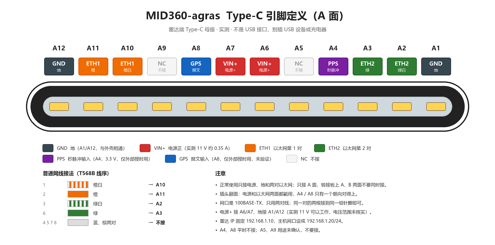

# MID360-agras（T100）激光雷达网口协议

[English](protocol.en.md) · [返回首页](../README.md)

本文写的是本仓库代码实际用到的部分：接线、地址端口、点云和 IMU 包、配置命令帧、解锁 360° 全周的完整报文，以及实测到的行为。内容以 `linux/mid360_agras.cpp`（收包解析）和 `tools/mid360_fov.py`（配置命令）为准。数值来自一两台雷达，别的批次和固件版本可能不同。

多字节字段都是小端。命令写成 `命令集/命令号`，例如 `32/12` 表示两个字节 `0x32 0x12`。

## 1 接线



雷达母座的 Type-C 不是 USB 接口。正常使用只接电源、地和两对以太网：

| 普通网线（T568B） | 颜色 | Type-C |
|---|---|---|
| 1 | 橙白 | A10 |
| 2 | 橙 | A11 |
| 3 | 绿白 | A2 |
| 6 | 绿 | A3 |
| 4、5、7、8 | 蓝、棕两对 | 不接 |

电源 + 接 A6 / A7，地接 A1 / A12。实测 11 V 时 0.345 A（约 3.8 W）可以工作，电压范围没有核实过。

同一列的 A、B 两个脚在雷达内部相通（测过 A10=B3、A11=B2、A2=B11、A3=B10），所以只接 A 面就够，转接板上不要把两面同时接通。插头翻面后电源和以太网照常能用。A4（PPS）和 A8（GPS 报文）翻面后会落到别的脚上，只有一个朝向对得上；它们只用于外部授时，本仓库不包含这部分，A8 的报文输入也没有验证过。A5、A9 用途未确认，不要接。

## 2 地址和端口

| 通道 | 方向 | 雷达侧端口 | 主机侧 |
|---|---|---|---|
| 点云 | 雷达 → 主机 | — | `192.168.1.20:60001` |
| IMU | 雷达 → 主机 | — | `192.168.1.20:60003` |
| 配置命令和应答 | 双向 | `60000` | 发送请求的同一个 socket |

雷达地址固定为 `192.168.1.10`。上电、网口连通后就开始向 `192.168.1.20` 推流，不需要主机发命令。

| | 开机默认 | 解锁后 |
|---|---|---|
| 点云包速率 | 约 3100 包/秒 | 约 2080 包/秒 |
| 点槽数（包速率 × 96） | 约 30 万/秒 | 约 20 万/秒 |

点槽里包含没有回波的点。IMU 实测 180–200 Hz。

## 3 点云和 IMU 包

### 3.1 包头（36 字节）

| 字段 | 偏移 | 类型 | 说明 |
|---|---|---|---|
| version | 0 | u8 | 版本，`0x01` |
| length | 1 | u16 | UDP 数据段总长度 |
| time_interval | 3 | u16 | 整包的采样时长，单位 0.1 µs |
| dot_num | 5 | u16 | 点数，点云包为 96 |
| udp_cnt | 7 | u16 | 包序号，会回绕；驱动用它统计丢包 |
| frame_cnt | 9 | u8 | 这台固件一直是 0，不能用来切帧 |
| data_type | 10 | u8 | 0 = IMU，1 = int32 毫米坐标 |
| time_type | 11 | u8 | 时间类型，正常使用时是 0 |
| reserved | 12 | 12 B | 保留 |
| crc32 | 24 | u32 | 驱动没有使用 |
| timestamp | 28 | u64 | 包内第一个点的时间，单位 ns，从雷达上电开始计时 |

解析代码也认 `data_type = 2`（int16 厘米坐标，每点 8 字节），这台雷达没有发过。

### 3.2 点云（`data_type = 1`）

整包 1380 字节 = 36 字节包头 + 96 × 14 字节。

| 字段 | 点内偏移 | 类型 | 说明 |
|---|---|---|---|
| x / y / z | 0 / 4 / 8 | int32 | 毫米，x 前、y 左、z 上 |
| reflectivity | 12 | u8 | 反射率 |
| tag | 13 | u8 | 标签，bit2 表示有测量值，bit4–5 为 0 |

- 两种点表示没有回波：坐标全零，和到原点正好 200 m 的标记点。驱动默认丢弃不大于 0.05 m 和不小于 100 m 的点。
- 第 i 个点的时间 = `timestamp + i × time_interval × 100 ns / 点数`。
- 4 条激光线在包内交错排列，线号 = `i mod 4`。

### 3.3 IMU（`data_type = 0`）

包头后面是 6 个 float32：`gyro_x / y / z`（rad/s）、`acc_x / y / z`（g）。加速度乘以 9.80665 得到 m/s²。

## 4 配置命令帧

请求发到雷达的 UDP `60000`，应答回到发送请求的 socket。

### 4.1 帧结构

| 字段 | 偏移 | 字节 | 说明 |
|---|---|---|---|
| sof | 0 | 1 | `0x55` |
| length_lo | 1 | 1 | 帧长（含头尾），低 8 位 |
| ver_len_hi | 2 | 1 | bit1:0 是长度的高 2 位，bit7:2 是版本 1 |
| crc8 | 3 | 1 | 校验前 3 个字节 |
| sender / receiver | 4 / 5 | 各 1 | 请求 `0x28` → `0xAD`，应答对调 |
| seq | 6 | 2 | 请求序号 |
| flags | 8 | 1 | 请求 `0x40`，应答的 bit7 为 1 |
| cmd_set / cmd_id | 9 / 10 | 各 1 | 命令 |
| payload | 11 | n | 载荷 |
| crc16 | 11+n | 2 | 校验从 sof 到载荷末尾 |

整帧长度 = 13 + n。

### 4.2 校验

两个校验都按“右移、反射多项式”计算，结果不异或。

| 校验 | 初值 | 反射多项式 | 范围 |
|---|---|---|---|
| CRC8 | `0x77` | `0x8C` | 帧的前 3 个字节 |
| CRC16 | `0x3692` | `0x8408` | sof 到载荷末尾 |

```python
def crc(data, c, poly):
    for b in data:
        c ^= b
        for _ in range(8):
            c = (c >> 1) ^ poly if c & 1 else c >> 1
    return c

assert crc(bytes.fromhex("551504"), 0x77, 0x8C) == 0xA9
```

### 4.3 命令

偏移从载荷起点算。

| 命令 | 用途 | 请求 | 应答 |
|---|---|---|---|
| `32/12` | 读参数 | `uid u32, len u32` | `ret u8, uid u32, len u16, 保留 u16, value`，value 从偏移 9 开始 |
| `32/13` | 写参数 | `uid u32, len u32, value` | `ret u8` |
| `32/14` | 采样使能 | `enable u8` | `ret u8` |
| `32/50` | 设目标状态 | `1 u16, 3 u32, 1 u16, state u8` | 第 1 字节是 ret |
| `32/51` | 读目标状态 | `1 u16, 3 u32` | 第 1 字节是 ret，最后 1 字节是状态 |

`ret` 为 0 表示成功。目标状态：1 采样，2 待机。

### 4.4 参数

| UID | 名称 | 长度 | 说明 |
|---|---|---|---|
| `0x00000003` | dev_type | 1 | 这台雷达读到 10 |
| `0x00000006` | line_num | 1 | 这台雷达读到 4 |
| `0x0001001B` | host_pcl_ip | 4 | 点云目的地址，字节反序：`192.168.1.20` 写 `14 01 A8 C0` |
| `0x0001001C` | host_pcl_port | 2 | 点云目的端口：60001 写 `61 EA` |
| `0x0001001D` | host_imu_ip | 4 | IMU 目的地址，字节反序 |
| `0x0001001E` | host_imu_port | 2 | IMU 目的端口：60003 写 `63 EA` |
| `0x00010023` | roi_en | 1 | 0 关闭扇区限制；bit0 / bit1 分别启用窗口 0 / 1 |
| `0x00010024` / `25` | 窗口 0 方位起 / 止 | 4 | int32，度 |
| `0x00010026` / `27` | 窗口 0 俯仰起 / 止 | 4 | int32，度，读到 −7 / 52 |
| `0x00010029` / `2A` | 窗口 1 方位起 / 止 | 4 | 同窗口 0 |
| `0x0001002B` / `2C` | 窗口 1 俯仰起 / 止 | 4 | 同窗口 0 |

## 5 解锁 360° 全周的完整报文

下面是 `mid360_fov.py --unlock` 实际发出的报文（本机 `192.168.1.20`，序号从 `0x0101` 开始）。竖线只是为了好读。工具每条命令等应答最多 0.8 秒，不重发。

| 步骤 | 请求 |
|---|---|
| 读 dev_type，确认雷达在 | `55 15 04 A9 \| 28 AD \| 01 01 \| 40 \| 32 12 \| 03 00 00 00 01 00 00 00 \| E2 31` |
| roi_en = 0 | `55 16 04 FC \| 28 AD \| 02 01 \| 40 \| 32 13 \| 23 00 01 00 01 00 00 00 00 \| 44 C5` |
| 目标状态 = 1 | `55 16 04 FC \| 28 AD \| 03 01 \| 40 \| 32 50 \| 01 00 03 00 00 00 01 00 01 \| D5 85` |
| 点云目的地址 | `55 19 04 E4 \| 28 AD \| 04 01 \| 40 \| 32 13 \| 1B 00 01 00 04 00 00 00 14 01 A8 C0 \| 16 2D` |
| 点云目的端口 | `55 17 04 38 \| 28 AD \| 05 01 \| 40 \| 32 13 \| 1C 00 01 00 02 00 00 00 61 EA \| 44 75` |
| IMU 目的地址 | `55 19 04 E4 \| 28 AD \| 06 01 \| 40 \| 32 13 \| 1D 00 01 00 04 00 00 00 14 01 A8 C0 \| C5 0A` |
| IMU 目的端口 | `55 17 04 38 \| 28 AD \| 07 01 \| 40 \| 32 13 \| 1E 00 01 00 02 00 00 00 63 EA \| EE 8E` |
| 采样使能 | `55 0E 04 66 \| 28 AD \| 08 01 \| 40 \| 32 14 \| 01 \| DC ED` |

之后读目标状态应该得到 1：

```text
55 13 04 03 | 28 AD | 09 01 | 40 | 32 51 | 01 00 03 00 00 00 | 46 CC
```

写 `host_pcl_port` 会让雷达重新选择数据流的目的地址，中间可能短暂收不到点云，所以工具每次改完参数都会把四个目的地址重写一遍，再打开采样使能。

## 6 实测行为

- 上电后没有任何命令时，目标状态读到 2（待机），但点云和 IMU 已经在推送。
- 解锁后目标状态读到 1，点云包速率从约 3100 包/秒变成约 2080 包/秒，方位角 360° 都有点。
- 断电或重启后，目标状态回到 2，包速率回到约 3100 包/秒，右后方约 65° 的缺口回来。此时 `roi_en` 读回来仍是 0，**不能用它判断是否解锁**。用目标状态、包速率，或者 `tools/pcl_measure.py` 的方位统计。
- 参数的存储值不一定随断电还原：实测有参数写入后断电重启，读回的仍是写入值。
- 写命令返回 0 只表示雷达接受了这条命令。要确认效果，看目标状态、包速率和点云本身。

## 7 本文没有写的

设备发现、状态推送、批量读写、软件重启、授时、固件升级等命令，本仓库没有用到，也没有写在这里。`0x55` 帧的更多命令可以对照公开资料 [sdcnm/T100-LiDAR](https://github.com/sdcnm/T100-LiDAR)（它有自己的许可条款）。
